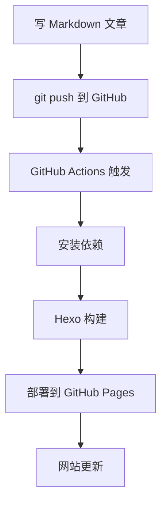
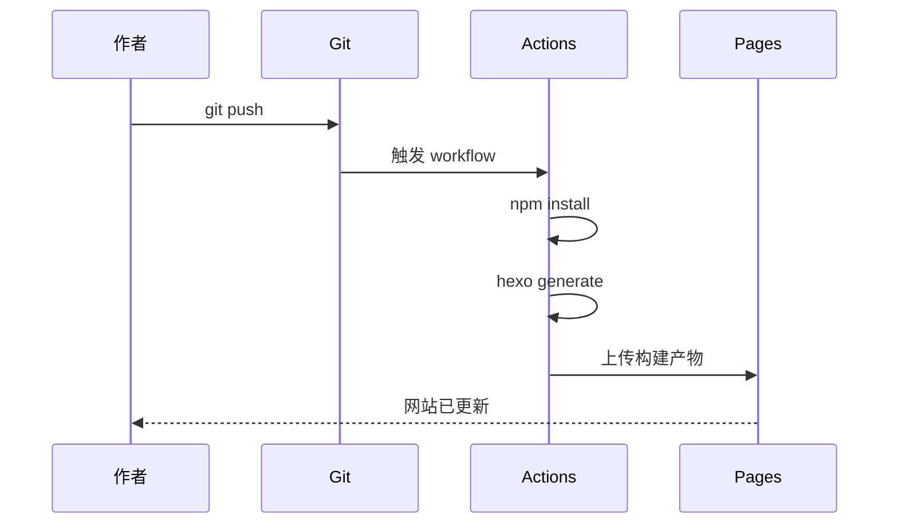

这篇文章展示博客支持的数学公式和流程图功能。

## 数学公式

行内公式：质能方程 $E = mc^2$，其中 $c$ 是光速。

块级公式：

$$
\int_{-\infty}^{\infty} e^{-x^2} dx = \sqrt{\pi}
$$

矩阵：

$$
\begin{bmatrix}
a_{11} & a_{12} & a_{13} \\
a_{21} & a_{22} & a_{23} \\
a_{31} & a_{32} & a_{33}
\end{bmatrix}
$$

求和公式：

$$
\sum_{i=1}^{n} i = \frac{n(n+1)}{2}
$$

## 流程图

用 Mermaid 画一个简单的部署流程：



时序图：



## 小结

- 数学公式：在文章 front-matter 加 `math: true`，然后用 `$...$`（行内）或 `$$...$$`（块级）写 LaTeX
- 流程图：在文章 front-matter 加 `mermaid: true`，然后用 ` ```mermaid ` 代码块写 Mermaid 语法
- 不需要这两个功能的文章不用加，页面加载更快
