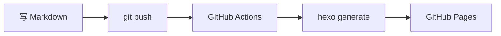

这篇文章列出 Fluid 主题内置的所有 Tag Plugins（自定义标签语法），写文章时可以直接套用。

## 1. 提示框 note

用于强调提示、警告、注意事项，比纯文本加粗醒目得多。

**语法：**


```markdown
 默认提示 
 主要提示 
 成功提示 
 信息提示 
 警告提示 
 危险提示 
```


**效果：**

 默认样式的提示 
 主要提示 
 成功提示 
 信息提示 
 警告：这个 API 在 Python 3.12 中已废弃 
 危险：删除操作不可逆，请确认后再执行 

## 2. 折叠区块 fold

把长代码、长输出、完整配置文件折叠起来，保持页面整洁。读者点击展开。

**语法：**


```markdown

（这里放任意 Markdown 内容，包括代码块）



（可以指定样式：default/primary/success/info/warning/danger）

```


**效果：**


```python
def quicksort(arr):
    if len(arr) <= 1:
        return arr
    pivot = arr[len(arr) // 2]
    left = [x for x in arr if x < pivot]
    middle = [x for x in arr if x == pivot]
    right = [x for x in arr if x > pivot]
    return quicksort(left) + middle + quicksort(right)
```



输出：[1, 2, 3, 5, 8, 13, 21]


## 3. 复选框 checkbox

用于 TODO 清单、学习进度跟踪。

**语法：**


```markdown
 已完成的事项
 待办的事项
```


**效果：**

 已完成：环境搭建
 已完成：第一篇博客
 待做：配置 CI/CD
 待做：写系列文章

## 4. 按钮 button

用于跳转链接、下载按钮，比纯链接更醒目。

**语法：**


```markdown


```


**效果：**




## 5. 标签 label

给文字加彩色标记。

**语法：**


```markdown






```


**效果：**

     

## 6. Mermaid 流程图

在 Front-matter 中加 `mermaid: true` 即可使用（本站已全局开启）。

**效果：**



## 7. 文章加密

在文章的 Front-matter 中加上 `password` 字段即可：


```yaml
---
title: 私密笔记
date: 2026-11-09 18:00:00
password: my-secret-123
---
```


访问该文章时会显示密码输入框，输入正确密码才能查看内容。适合发布课程笔记、面试准备等不想完全公开的内容。

## 8. 数学公式

在 Front-matter 中加 `math: true` 即可使用 KaTeX 渲染：

行内公式：$E = mc^2$

块级公式：

$$
\sum_{i=1}^{n} i = \frac{n(n+1)}{2}
$$

$$
\mathcal{L}(\theta) = -\frac{1}{N} \sum_{i=1}^{N} \left[ y_i \log \hat{y}_i + (1-y_i) \log(1-\hat{y}_i) \right]
$$
