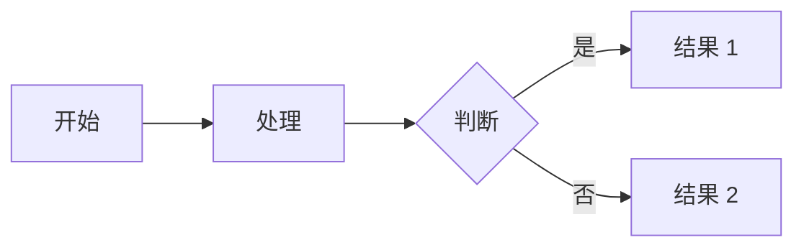

# LingXifeng 博客使用说明书

> 本文档是博客的完整使用指南，涵盖日常写作、功能用法、本地预览、部署流程和常见问题。
>
> 博客地址：https://lingxifeng.github.io
> 仓库地址：https://github.com/LingXifeng/LingXifeng.github.io

---

## 目录

1. [快速开始：写一篇新文章](#1-快速开始写一篇新文章)
2. [文章 Front-matter 详解](#2-文章-front-matter-详解)
3. [本地预览](#3-本地预览)
4A. [发布到线上](#4-发布到线上)
5. [已配置功能速查](#5-已配置功能速查)
6. [Markdown 写作指南](#6-markdown-写作指南)
7. [Tag Plugins 标签语法](#7-tag-plugins-标签语法)
8. [文章加密](#8-文章加密)
9. [图片管理](#9-图片管理)
10. [更换背景配色](#10-更换背景配色)
11. [评论系统配置](#11-评论系统配置)
12. [访问分析配置](#12-访问分析配置)
13. [常见操作](#13-常见操作)
14. [常见问题](#14-常见问题)
15. [项目文件结构](#15-项目文件结构)

---

## 1. 快速开始：写一篇新文章

### 三步发布

```bash
# 第 1 步：创建新文章（会自动生成 .md 文件和同名图片文件夹）
npx hexo new "我的新文章"

# 第 2 步：编辑文章内容
# 打开 source/_posts/我的新文章.md 写你想要的内容

# 第 3 步：推送到 GitHub，自动部署
git add -A
git commit -m "发布新文章：我的新文章"
git push
```

推送后约 1-2 分钟，文章就会出现在 https://lingxifeng.github.io

### 创建后的文件

```
source/_posts/
  ├── 我的新文章.md       ← 文章内容，用 Markdown 写
  └── 我的新文章/         ← 图片文件夹（放这篇文章的图片）
```

---

## 2. 文章 Front-matter 详解

每篇文章开头的 `---` 之间的部分叫 Front-matter，是文章的元数据配置：

```yaml
---
title: 文章标题                    # 必填，文章标题
date: 2026-11-09 20:00:00         # 必填，发布日期
categories: [技术]                # 分类，可以有多个 [技术, 前端]
tags: [Hexo, CSS]                 # 标签，可以有多个
sticky: 100                       # 可选，置顶优先级，数字越大越靠前
password: my-secret-123           # 可选，加密文章的密码
math: true                        # 可选，强制开启数学公式（默认已全局开启）
mermaid: true                     # 可选，强制开启流程图（默认已全局开启）
banner_img: /img/my-banner.jpg    # 可选，这篇文章专属的顶部大图
abbrlink: 3a8b2c1d                # 自动生成，不要手动改，这是永久链接 ID
---
```

### 常用组合示例

**普通技术文章：**
```yaml
---
title: Docker 入门教程
date: 2026-11-10 10:00:00
categories: [技术]
tags: [Docker, 容器]
---
```

**置顶文章：**
```yaml
---
title: 博客使用指南
date: 2026-11-09 20:00:00
categories: [公告]
tags: [Hexo]
sticky: 100
---
```

**加密文章（私密笔记）：**
```yaml
---
title: 面试准备笔记
date: 2026-11-10 15:00:00
categories: [随笔]
tags: [面试]
password: my-password
---
```

---

## 3. 本地预览

发布前可以在本地预览效果：

```bash
# 启动本地服务器
npx hexo server

# 然后浏览器打开 http://localhost:4000
# 按 Ctrl+C 停止
```

### 清理后重新生成

如果改了配置文件，建议先清理再预览：

```bash
npx hexo clean          # 清理生成的文件
npx hexo generate       # 重新生成
npx hexo server         # 启动预览
```

---

## 4. 发布到线上

### 方式一：命令行推送（推荐）

```bash
git add -A
git commit -m "发布文章：文章标题"
git push
```

推送后 GitHub Actions 自动执行：
1. 安装 Node.js 22
2. `npm install` 安装依赖
3. `hexo generate` 生成静态页面
4. 部署到 GitHub Pages

全程自动，约 1-2 分钟完成。

### 方式二：GitHub 网页直接编辑

1. 打开 https://github.com/LingXifeng/LingXifeng.github.io
2. 进入 `source/_posts/` 目录
3. 点 "Add file" → "Create new file"
4. 文件名写 `文章标题.md`，内容写 Markdown
5. 点 "Commit changes"，自动触发部署

> 注意：网页编辑无法使用本地预览，适合快速发短文。

### 查看部署状态

打开 https://github.com/LingXifeng/LingXifeng.github.io/actions
可以看到每次部署的进度和日志。绿色 ✓ = 成功，红色 ✗ = 失败。

---

## 5. 已配置功能速查

| 功能 | 状态 | 怎么用 |
|------|------|--------|
| 永久链接 | ✅ 已开启 | 自动生效，文章 URL 为 `/posts/abbrlink/` |
| 文章加密 | ✅ 已开启 | Front-matter 加 `password: xxx` |
| GitHub Emoji | ✅ 已开启 | Markdown 里写 `:rocket:` `:bug:` 等 |
| 数学公式 | ✅ 已开启 | 用 `$...$`（行内）和 `$$...$$`（块级） |
| Mermaid 流程图 | ✅ 已开启 | 用 ` ```mermaid ` 代码块 |
| 文章置顶 | ✅ 已开启 | Front-matter 加 `sticky: 100` |
| 资源文件夹 | ✅ 已开启 | `hexo new` 自动创建同名文件夹 |
| 暗黑模式 | ✅ 已开启 | 右上角切换按钮，默认跟随系统 |
| 本地搜索 | ✅ 已开启 | 导航栏搜索框 |
| RSS 订阅 | ✅ 已开启 | https://lingxifeng.github.io/atom.xml |
| Sitemap | ✅ 已开启 | https://lingxifeng.github.io/sitemap.xml |
| robots.txt | ✅ 已开启 | https://lingxifeng.github.io/robots.txt |
| 外链 nofollow | ✅ 已开启 | 自动给外部链接加 nofollow |
| canonical 链接 | ✅ 已开启 | 自动生成，SEO 用 |
| HTML/CSS 压缩 | ✅ 已开启 | 自动压缩，加快加载 |
| 图片懒加载 | ✅ 已开启 | 图片滚动到可视区域才加载 |
| 代码复制按钮 | ✅ 已开启 | 代码块右上角复制按钮 |
| 代码行号 | ✅ 已开启 | 代码块自动显示行号 |
| 暗黑模式代码高亮 | ✅ 已开启 | 暗黑模式下自动切换代码主题 |
| TOC 目录 | ✅ 已开启 | 文章右侧自动生成目录 |
| 字数统计 | ✅ 已开启 | 文章元信息显示字数 |
| 阅读时长 | ✅ 已开启 | 文章元信息显示预计阅读时间 |
| 浏览量 | ✅ 已开启 | 文章元信息显示浏览量（不蒜子） |
| 页脚 PV/UV | ✅ 已开启 | 页脚显示全站访问统计 |
| 版权声明 | ✅ 已开启 | 文章底部自动生成 CC BY-NC-SA 声明 |
| 脚注 | ✅ 已开启 | Markdown `[^1]` 语法 |
| 图片放大 | ✅ 已开启 | 点击图片放大查看 |
| 图片说明 | ✅ 已开启 | 图片下方自动显示 alt 文字 |
| 锚点链接 | ✅ 已开启 | 标题左侧出现链接图标 |
| 滚动进度条 | ✅ 已开启 | 页面顶部蓝色进度条 |
| 打字机效果 | ✅ 已开启 | 首页标语打字机动画 |
| 毛玻璃导航栏 | ✅ 已开启 | 导航栏半透明毛玻璃效果 |
| 404 页面 | ✅ 已开启 | 自动生成 404 页 |
| 评论系统 | ⏳ 待配置 | 需填 Gitalk 或 Giscus 的 ID |
| 访问分析 | ⏳ 待配置 | 需填 Google Analytics ID |


---

## 6. Markdown 写作指南

### 基础语法

```markdown
# 一级标题
## 二级标题
### 三级标题

**加粗文字**
*斜体文字*
~~删除线~~

- 无序列表项 1
- 无序列表项 2

1. 有序列表项 1
2. 有序列表项 2

[链接文字](https://example.com)


> 引用文字

`行内代码`

| 表头 1 | 表头 2 |
|--------|--------|
| 内容 1 | 内容 2 |
```

### 代码块

````markdown
```python
def hello():
    print("Hello, World!")
```
````

支持的语言高亮：python、javascript、java、c、cpp、go、rust、sql、yaml、json、bash、html、css 等。

### 数学公式

行内公式：`$E = mc^2$`

块级公式：
```markdown
$$
\int_{-\infty}^{\infty} e^{-x^2} dx = \sqrt{\pi}
$$
```

### Mermaid 流程图

````markdown

````

### GitHub Emoji

在 Markdown 里直接写：

```markdown
:rocket: 部署成功！
:bug: 修复了一个 bug
:books: 推荐书籍
:warning: 注意事项
:checkered_flag: 完成
:construction: 施工中
```

完整列表：https://github.com/github/gemoji/blob/master/db/emoji.json

### 脚注

```markdown
这是一个带脚注的文字[^1]。

[^1]: 脚注的详细内容。
```

---

## 7. Tag Plugins 标签语法

Fluid 主题内置的自定义标签，写文章时直接用：

### 提示框 note

```markdown
 默认提示 
 主要提示 
 成功提示 
 信息提示 
 警告提示 
 危险提示 
```

### 折叠区块 fold

```markdown

（代码内容）



这里是需要注意的内容

```

### 复选框 checkbox

```markdown
 已完成的事项
 待办的事项
```

### 按钮 button

```markdown

```

### 彩色标签 label

```markdown




```

> **提示**：在代码块里展示以上语法时，要用 `...` 包裹，否则会被 Hexo 解析执行。

---

## 8. 文章加密

### 加密一篇文章

在文章的 Front-matter 中加 `password` 字段：

```yaml
---
title: 私密笔记
date: 2026-11-10 15:00:00
categories: [随笔]
password: my-secret-123
---
```

### 效果

- 文章列表中只显示标题和"这篇文章已加密"提示
- 点进去需要输入密码才能看到内容
- 密码错误会提示重新输入

### 适用场景

- 课程笔记、作业（不想完全公开）
- 面试准备材料
- 草稿（还没写完不想让人看）
- 给特定人看的内容（把密码告诉对方即可）

---

## 9. 图片管理

### 方式一：文章资源文件夹（推荐）

每篇文章有自己的图片文件夹，图片跟着文章走：

```bash
npx hexo new "我的文章"
# 生成：
# source/_posts/我的文章.md
# source/_posts/我的文章/    ← 图片放这里
```

把图片放进文件夹后，在文章中引用：

```markdown

```

### 方式二：全局图片目录

把图片放在 `themes/fluid/source/img/` 下，所有文章都能引用：

```markdown

```

### 方式三：外链图片

直接用网络图片 URL：

```markdown

```

> 注意：外链图片可能因对方服务器问题失效，重要图片建议下载到本地用方式一。

### 文章顶部大图（banner）

在 Front-matter 中指定：

```yaml
---
title: 我的文章
banner_img: /img/my-banner.jpg
banner_img_height: "60"    # 显示图片上方 60% 区域
---
```

---

## 10. 更换背景配色

### 修改位置

文件：`_config.fluid.yml` 中的 `color` 配置块：

```yaml
color:
  body_bg_color: "#d6d5e6"        # 页面底色（浅色模式）
  body_bg_color_dark: "#262429"   # 页面底色（暗黑模式）
  navbar_bg_color: "#3a3548"      # 导航栏颜色（浅色模式）
  navbar_bg_color_dark: "#1f1a2a" # 导航栏颜色（暗黑模式）
  board_color: "#ffffff"          # 正文区域颜色（浅色模式）
  board_color_dark: "#333037"     # 正文区域颜色（暗黑模式）
```

### 配色建议

| 风格 | body 底色 | board 正文色 | 导航栏 |
|------|-----------|-------------|--------|
| 蓝紫（当前） | `#d6d5e6` | `#ffffff` | `#3a3548` |
| 护眼绿 | `#e8f5e9` | `#f1f8e9` | `#2e4b3e` |
| 暖灰 | `#f5f0eb` | `#ffffff` | `#4a3f35` |
| 纯白简约 | `#ffffff` | `#ffffff` | `#333333` |
| 深蓝 | `#e3f2fd` | `#ffffff` | `#1a365d` |

---

## 11. 评论系统配置

### 方案 A：Giscus（推荐）

基于 GitHub Discussions，不需要 Client Secret。

**配置步骤：**

1. 打开仓库 https://github.com/LingXifeng/LingXifeng.github.io
2. Settings → General → Features → 勾选 **Discussions**
3. 安装 giscus app：https://github.com/apps/giscus/installations/new
4. 打开 https://giscus.app ，填入仓库信息，生成配置参数
5. 把生成的 `repo_id` 和 `category_id` 填入 `_config.fluid.yml`：
   ```yaml
   giscus:
     repo: LingXifeng/LingXifeng.github.io
     repo_id: R_xxxxxx          # 从 giscus.app 复制
     category: Announcements
     category_id: DIC_xxxxxx    # 从 giscus.app 复制
   ```
6. 把评论类型改为 giscus：
   ```yaml
   post:
     comments:
       type: giscus    # 从 gitalk 改为 giscus
   ```
7. `git push` 部署

### 方案 B：Gitalk

基于 GitHub Issues，需要 OAuth App。

**配置步骤：**

1. 打开 https://github.com/settings/applications/new
2. 填写：
   - Application name: `LingXifeng Blog Comments`
   - Homepage URL: `https://lingxifeng.github.io`
   - Callback URL: `https://lingxifeng.github.io`
3. 注册后获取 Client ID 和 Client Secret
4. 填入 `_config.fluid.yml`：
   ```yaml
   gitalk:
     clientID: 你的-Client-ID
     clientSecret: 你的-Client-Secret
   ```
5. `git push` 部署
6. 第一次打开文章页时，用 GitHub 账号登录，自动创建 Issue

> Giscus 比 Gitalk 好：不需要 Secret，评论存在 Discussions 更整洁，支持表情反应。

---

## 12. 访问分析配置

### Google Analytics

1. 打开 https://analytics.google.com
2. 创建媒体属性 → 获取 Measurement ID（格式 `G-XXXXXXXXXX`）
3. 填入 `_config.fluid.yml`：
   ```yaml
   web_analytics:
     enable: true                    # 改为 true
     google:
       measurement_id: G-XXXXXXXXXX  # 填你的 ID
   ```
4. `git push` 部署

### 效果

配置后可以在 Google Analytics 看到：
- 每篇文章的访问量
- 读者地理位置
- 访问来源（搜索引擎、直接访问、外链）
- 停留时间、跳出率等


---

## 13. 常见操作

### 创建文章

```bash
npx hexo new "文章标题"
```

### 创建草稿

```bash
npx hexo new draft "草稿标题"
# 草稿在 source/_drafts/ 下，不会发布到线上
# 写完后移动到 _posts：
# mv source/_drafts/草稿标题.md source/_posts/
```

### 创建页面

```bash
npx hexo new page "页面名称"
# 在 source/页面名称/ 下生成 index.md
```

### 删除文章

```bash
# 直接删除 .md 文件和同名文件夹
rm source/_posts/文章标题.md
rm -rf source/_posts/文章标题/

# 然后提交
git add -A
git commit -m "删除文章：文章标题"
git push
```

### 修改文章

直接编辑 `source/_posts/文章名.md`，然后 `git push`。

### 修改博客配置

| 配置文件 | 作用 | 常见修改 |
|----------|------|----------|
| `_config.yml` | Hexo 主配置 | 站点标题、作者、永久链接、插件配置 |
| `_config.fluid.yml` | 主题配置 | 导航栏、背景色、评论、功能开关 |

改完后：
```bash
npx hexo clean && npx hexo generate  # 本地验证
git add -A && git commit -m "修改配置" && git push  # 部署
```

### 更新依赖

```bash
npm update          # 更新所有插件
# 或者更新指定插件
npm update hexo --save
```

---

## 14. 常见问题

### Q: 推送后页面没更新？

1. 检查 https://github.com/LingXifeng/LingXifeng.github.io/actions 部署是否成功
2. 如果失败，点进去看日志，通常是文章 Markdown 语法错误
3. 浏览器强制刷新（Ctrl+Shift+R），GitHub Pages 有时有缓存

### Q: 文章 URL 变了怎么办？

不会变。已开启 `hexo-abbrlink`，每篇文章有一个固定的短链接 ID（如 `/posts/3a8b2c1d/`），改标题、改日期都不会变 URL。

### Q: 怎么修改文章的 URL？

文章的 `abbrlink` 是自动生成且固定的，不建议手动改。如果一定要改：
1. 删除文章 Front-matter 里的 `abbrlink` 行
2. 运行 `npx hexo clean && npx hexo generate`，会重新生成一个新的

### Q: 图片显示不出来？

1. 检查图片路径是否正确
2. 用文章资源文件夹时，路径写 ``，不需要 `source/_posts/` 前缀
3. 用全局图片时，路径写 `/img/图片名.png`
4. 检查图片文件名是否有中文或空格，建议用英文命名

### Q: 数学公式不显示？

1. 确认文章 Front-matter 有 `math: true`（或者全局已开启则不需要）
2. 行内公式用 `$...$`，块级用 `$$...$$`
3. 公式里不要有多余的空格或换行

### Q: Mermaid 流程图不显示？

1. 确认 Front-matter 有 `mermaid: true`（或者全局已开启）
2. 确认用的是 ` ```mermaid ` 代码块，不是普通代码块

### Q: 加密文章忘记密码？

直接编辑文章的 `.md` 文件，删除 `password` 行，重新 `git push` 即可。

### Q: 本地预览报错？

```bash
# 清理后重试
npx hexo clean
npx hexo generate
npx hexo server

# 如果还报错，检查最近修改的文件是否有语法错误
```

### Q: 怎么添加新的导航菜单项？

编辑 `_config.fluid.yml`：

```yaml
navbar:
  menu:
    - { key: "首页", link: "/", icon: "iconfont icon-homefill" }
    - { key: "归档", link: "/archives/", icon: "iconfont icon-archive" }
    # 添加新菜单项：
    - { key: "项目", link: "/projects/", icon: "iconfont icon-code" }
```

然后创建对应页面：`npx hexo new page projects`

### Q: 怎么修改首页标语？

编辑 `_config.fluid.yml`：

```yaml
index:
  slogan:
    text: "你的新标语"
```

### Q: 怎么修改"关于"页面内容？

编辑 `source/about/index.md`，用 Markdown 写你想要的自我介绍。

---

## 15. 项目文件结构

```
LingXifeng.github.io/
│
├── _config.yml                 # Hexo 主配置（站点信息、永久链接、插件配置）
├── _config.fluid.yml           # Fluid 主题配置（导航、配色、评论、功能开关）
├── package.json                # Node.js 依赖声明
├── 使用说明书.md               # 本文档
│
├── source/                     # ★ 你的内容都在这里
│   ├── _posts/                 #   博客文章（Markdown）
│   │   ├── hello-world.md
│   │   ├── build-blog-with-hexo.md
│   │   ├── math-and-mermaid-demo.md
│   │   ├── tag-plugins-guide.md
│   │   └── advanced-features-demo.md
│   ├── about/index.md          #   关于页面
│   ├── tags/index.md           #   标签页
│   ├── categories/index.md     #   分类页
│   └── links/index.md          #   友链页
│
├── scaffolds/                  # 文章模板
│   ├── post.md                 #   新文章模板
│   ├── draft.md                #   草稿模板
│   └── page.md                 #   页面模板
│
├── themes/fluid/               # Fluid 主题源码（一般不用改）
│   ├── source/
│   │   ├── img/                #   主题图片（背景图、头像放这里）
│   │   ├── css/                #   主题样式
│   │   └── js/                 #   主题脚本
│   └── layout/                 #   主题模板
│
├── .github/
│   ├── workflows/deploy.yml    # GitHub Actions 自动部署配置
│   └── dependabot.yml          # 依赖自动更新配置
│
└── public/                     # 生成的静态文件（git ignore，不要手动改）
```

### 你平时只需要关心

| 目录/文件 | 你会做什么 |
|-----------|-----------|
| `source/_posts/` | 写文章、删文章 |
| `source/about/index.md` | 改关于页面 |
| `_config.yml` | 改站点信息、插件配置 |
| `_config.fluid.yml` | 改主题外观、功能开关 |
| `themes/fluid/source/img/` | 放背景图、头像等图片 |

其他文件不用动。

---

## 快速参考卡

```
写文章：    npx hexo new "标题" → 编辑 → git push
本地预览：  npx hexo server → 打开 localhost:4000
加密文章：  Front-matter 加 password: xxx
置顶文章：  Front-matter 加 sticky: 100
改背景色：  _config.fluid.yml 的 color 块
改导航栏：  _config.fluid.yml 的 navbar.menu
看部署状态：github.com/LingXifeng/LingXifeng.github.io/actions
```
